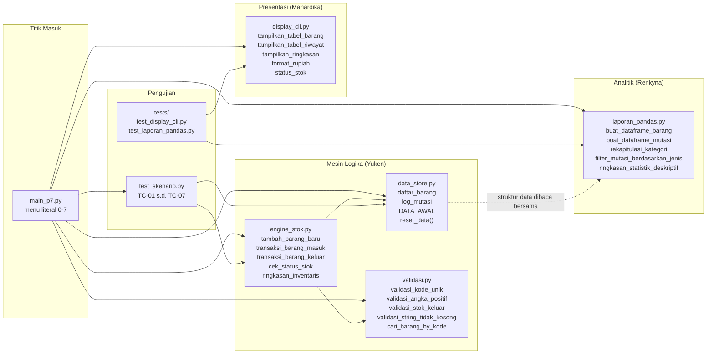
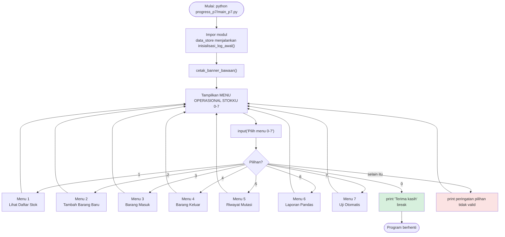
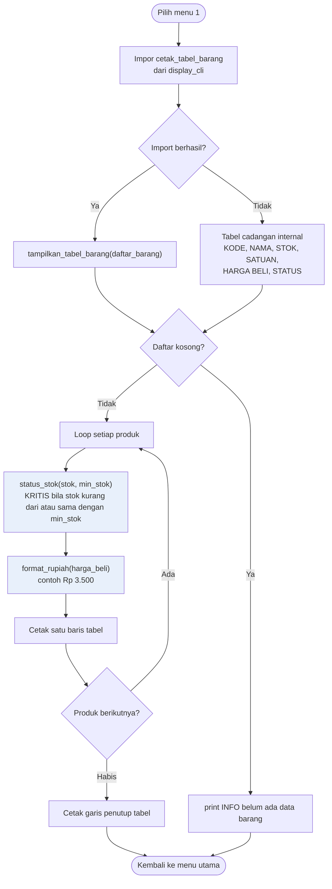
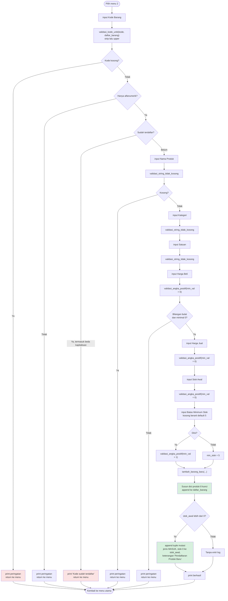
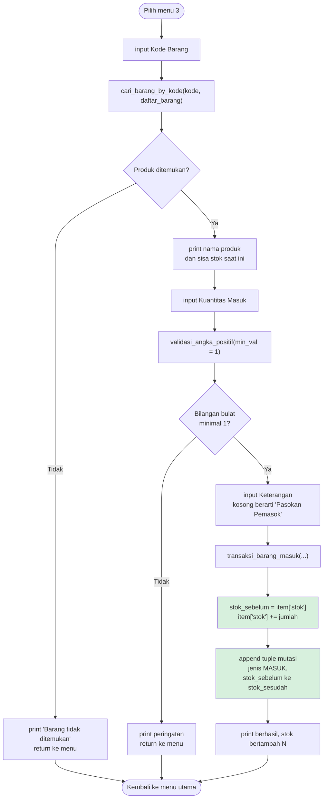
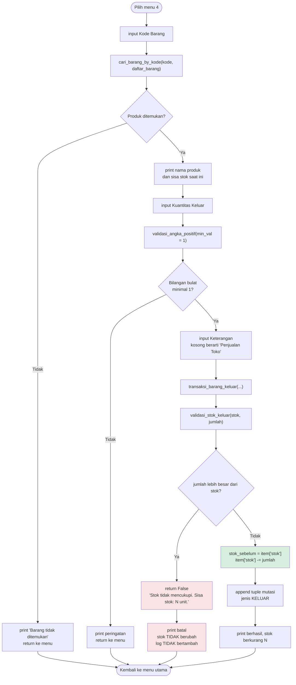
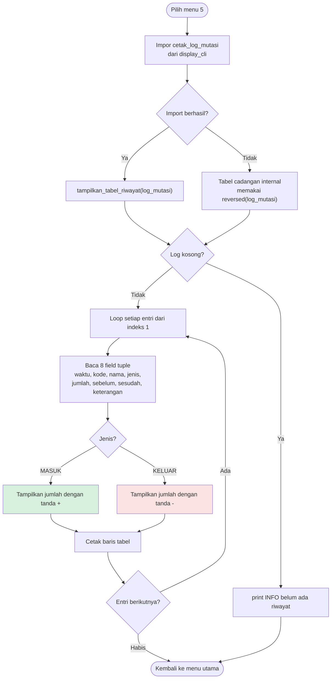
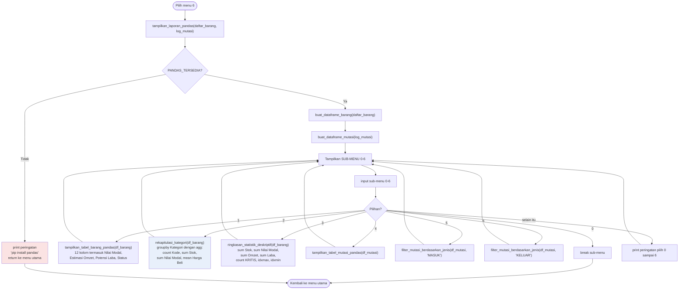
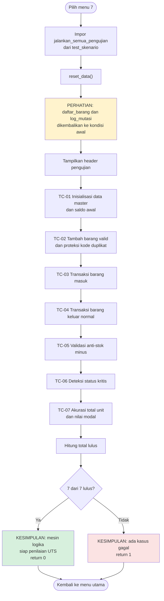
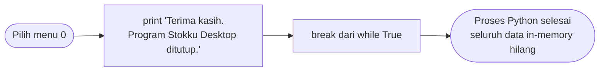

# Stokku Desktop

> Aplikasi manajemen persediaan dan pencatatan mutasi stok gudang UMKM berbasis Python, berjalan sepenuhnya luring (*offline-first*) tanpa server dan tanpa koneksi internet.

[](https://www.python.org/)
[%20Selesai-brightgreen.svg)](#status-implementasi)
[](#hasil-pengujian)
[](LICENSE)

---

## Informasi Akademik

- Perguruan Tinggi: Universitas Bina Sarana Informatika (UBSI)
- Program Studi / Kelas: Teknik Informatika / 15.1C.30
- Mata Kuliah: Dasar Pemrograman (Kode: 894, 4 SKS)
- Dosen Pengampu: Ali Mustopa, M.Kom (Kode Dosen: AOP)
- Kelompok: 4 (Empat)

### Anggota Tim Pengembang

| No | NIM | Nama Lengkap | Akun GitHub | Peran Utama |
| :---: | :---: | :--- | :--- | :--- |
| 1 | **15260767** | **YUKEN VELINO** | [@Curzyori](https://github.com/Curzyori) | Project Lead, Logika Backend, Validasi & Test Runner |
| 2 | **15260673** | **MAHARDIKA ATHAILLAH** | [@dikah4300](https://github.com/dikah4300) | Tampilan Antarmuka (UI) & Desain Presentasi |
| 3 | **15260847** | **RENKYNA AFTANIA NASUTION** | [@renkynatania-dotcom](https://github.com/renkynatania-dotcom) | Modul Analisis Pandas (P7) & Dokumentasi Akademik |

---

## Latar Belakang

Pencatatan persediaan barang pada toko kelontong atau gudang UMKM masih banyak dilakukan manual pada buku tulis. Cara manual menimbulkan empat kendala:

- Jumlah stok fisik tidak terpantau sebelum dilakukan penghitungan ulang fisik (*stock opname*).
- Barang di rak sudah habis tanpa peringatan dini untuk memesan kembali.
- Selisih stok akibat barang rusak, kedaluwarsa, atau pemakaian sendiri yang terlewat dicatat.
- Sulit mengetahui total modal belanja yang masih tersimpan dalam bentuk barang di gudang.

Stokku Desktop mencatat barang dan mutasi keluar-masuk secara terstruktur, menolak transaksi yang akan membuat stok minus, dan menghitung total modal persediaan secara otomatis.

---

## Status Implementasi

Proyek ini dibagi dua fase mengikuti silabus perkuliahan.

| Fase | Target | Silabus | Antarmuka | Penyimpanan | Status |
| :--- | :--- | :--- | :--- | :--- | :--- |
| **1.0** | UTS Pertemuan 8 | P01 s.d. P07 | CLI terminal | In-memory (`list` & `dict`) | **Selesai** |
| **2.0** | UAS Pertemuan 11 s.d. 16 | P09 s.d. P16 | Desktop Tkinter | SQLite3 (`stok_gudang.db`) | Belum dimulai |

Badge SQLite3 dan Tkinter pada versi sebelumnya sengaja dipindahkan ke tabel ini karena keduanya baru ada di Fase 2. Kode Fase 2 belum ditulis, sehingga direktori `app/` dan `main.py` belum ada di repositori.

---

## Fitur yang Sudah Berjalan (Fase 1)

Fitur di bawah ini benar-benar tersedia dan sudah diuji saat ini.

| No Menu | Nama Menu | Yang Benar-Benar Dilakukan Kode |
| :---: | :--- | :--- |
| 1 | Lihat Daftar Stok Barang & Status Kritis | Mencetak tabel seluruh produk: kode, nama, kategori, satuan, harga beli, harga jual, stok, batas minimum, dan status `[KRITIS]` / `[AMAN]` |
| 2 | Tambah Data Barang Baru | Form 8 kolom input dengan validasi keunikan kode (case-insensitive), validasi angka, dan pencatatan log saldo awal otomatis |
| 3 | Transaksi Barang Masuk (Restock) | Menambah stok (`+=`) dan mencatat baris mutasi `MASUK` |
| 4 | Transaksi Barang Keluar (Anti-Stok Minus) | Mengurangi stok (`-=`) dengan pembatalan otomatis bila kuantitas melebihi stok fisik |
| 5 | Lihat Riwayat Mutasi Arus Barang | Mencetak seluruh log mutasi berurutan kronologis naik (entri terlama di atas) |
| 6 | Laporan Analisis Persediaan (P7) | Sub-menu Pandas: DataFrame master, `groupby` kategori, statistik deskriptif, dan filter mutasi |
| 7 | Jalankan Skrip Uji Otomatis | Menjalankan TC-01 s.d. TC-07 tanpa input manual |
| 0 | Keluar dari Program | Menghentikan perulangan menu |

### Batasan Fase 1 yang Perlu Diketahui

1. **Data hilang saat program ditutup.** Semua data disimpan di memori (`list` dan `dict`). Menutup terminal mengembalikan data ke 3 produk bawaan.
2. **Menu 7 mereset data.** `jalankan_semua_pengujian()` memanggil `reset_data()` di awal, sehingga data yang sudah Anda input akan kembali ke kondisi awal setelah pengujian. Ini disengaja agar hasil uji deterministik.
3. **Belum ada Ubah, Hapus, dan Pencarian barang di CLI.** Ketiga fitur tersebut dijadwalkan pada Fase 2 (GUI). Lihat [Roadmap](#roadmap-fase-2).
4. **Riwayat mutasi berurutan naik** dari entri terlama ke terbaru. Filter per jenis mutasi tersedia di dalam Menu 6 (sub-menu 4, 5, dan 6).
5. **Menu 1 menampilkan tabel saja**, tanpa kartu ringkasan. Fungsi `tampilkan_ringkasan()` tersedia di `display_cli.py` dan baru akan dipakai pada Fase 2.

---

## Arsitektur Sistem



### Ketergantungan Modul

```text
main_p7.py
├── data_store.py          (tanpa dependensi internal)
├── validasi.py            (tanpa dependensi internal)
├── engine_stok.py   ─────► validasi.py
├── display_cli.py         (tanpa dependensi internal)
├── laporan_pandas.py      (pandas opsional, dibungkus try/except ImportError)
└── test_skenario.py ─────► data_store.py, validasi.py, engine_stok.py
```

`main_p7.py` memakai blok `try/except ImportError` untuk memanggil `display_cli` dan `laporan_pandas`. Kalau kedua modul itu belum ada, program tetap berjalan memakai tabel cadangan internal. Ini yang membuat program tidak pernah gagal karena satu modul hilang.

---

## Struktur Data (Variabel dan Alasannya)

### Variabel Utama

| Variabel | Tipe | Berkas | Isi | Mengapa Dipakai Tipe Ini |
| :--- | :--- | :--- | :--- | :--- |
| `DATA_AWAL` | `list[dict]` | `data_store.py` | Template 3 produk awal | Konstanta pembanding; dipakai ulang oleh `reset_data()` tanpa risiko termutasi karena disalin per elemen |
| `daftar_barang` | `list[dict]` | `data_store.py` | Master seluruh produk aktif | Setiap produk punya 8 atribut bernama. `dict` memungkinkan akses per nama kunci (`item["stok"]`) dan nilainya bisa diubah saat mutasi (`mutable`) |
| `log_mutasi` | `list[tuple]` | `data_store.py` | Jejak audit seluruh transaksi | `tuple` bersifat `immutable`, sehingga baris riwayat yang sudah tercatat tidak bisa diubah atau terhapus tidak sengaja. Ini menjaga integritas audit |
| `PANDAS_TERSEDIA` | `bool` | `laporan_pandas.py` | Penanda pandas terpasang | *Feature flag* agar modul tetap bisa diimpor saat pandas belum ada, tanpa crash |
| `df_barang` | `pandas.DataFrame` | `laporan_pandas.py` | Matriks produk 12 kolom | Struktur dua dimensi berlabel, syarat operasi `groupby`, `sum`, `idxmax` (materi P07) |
| `df_mutasi` | `pandas.DataFrame` | `laporan_pandas.py` | Matriks riwayat 8 kolom | Memudahkan filter per jenis transaksi dan pencetakan tabel |

### Skema Dictionary Produk

Setiap elemen `daftar_barang` berbentuk:

| Kunci | Tipe | Contoh | Keterangan |
| :--- | :--- | :--- | :--- |
| `kode` | `str` | `"ATK01"` | Unik, alfanumerik, selalu huruf kapital |
| `nama` | `str` | `"Buku Tulis Kiky 38 Lembar"` | Nama produk |
| `kategori` | `str` | `"ATK"` | Dasar agregasi `groupby` |
| `satuan` | `str` | `"Pcs"` | Satuan mutasi |
| `harga_beli` | `int` | `3500` | Rupiah, dipakai menghitung nilai modal |
| `harga_jual` | `int` | `5000` | Rupiah, dipakai menghitung potensi laba |
| `stok` | `int` | `15` | Kuantitas fisik, tidak pernah negatif |
| `min_stok` | `int` | `5` | Ambang batas status `[KRITIS]` |

### Skema Tuple Mutasi

Setiap elemen `log_mutasi` berbentuk 8-tuple berurutan:

| Indeks | Nama | Tipe | Contoh |
| :---: | :--- | :--- | :--- |
| 0 | `waktu` | `str` | `"2026-11-13 08:42:00"` |
| 1 | `kode` | `str` | `"ATK01"` |
| 2 | `nama` | `str` | `"Buku Tulis Kiky 38 Lembar"` |
| 3 | `jenis` | `str` | `"MASUK"` atau `"KELUAR"` |
| 4 | `jumlah` | `int` | `5` |
| 5 | `stok_sebelum` | `int` | `15` |
| 6 | `stok_sesudah` | `int` | `20` |
| 7 | `keterangan` | `str` | `"Pasokan Pemasok"` |

---

## Alur Program Utama



---

## Alur Detail Setiap Menu

### Menu 1: Lihat Daftar Stok Barang & Status Kritis



**Rumus status:** `status = KRITIS` jika `stok <= min_stok`, selain itu `AMAN`.

---

### Menu 2: Tambah Data Barang Baru

Ini menu paling panjang karena meminta delapan input berurutan, masing-masing dengan validasi sendiri.



**Aturan validasi:**

| Kolom | Aturan | Pesan bila gagal |
| :--- | :--- | :--- |
| Kode | Tidak kosong, alfanumerik, unik tanpa membedakan huruf besar-kecil | "Kode barang tidak boleh kosong" / "hanya boleh huruf dan angka" / "sudah terdaftar" |
| Nama, Kategori, Satuan | Tidak boleh kosong | "... tidak boleh kosong" |
| Harga Beli, Harga Jual | Bilangan bulat, minimal 0 | "... harus berupa bilangan bulat" |
| Stok Awal | Bilangan bulat, minimal 0 | idem |
| Batas Minimum | Bilangan bulat, minimal 1, default 5 | "minimal bernilai 1" |

---

### Menu 3: Transaksi Barang Masuk (Restock)



---

### Menu 4: Transaksi Barang Keluar (Anti-Stok Minus)

Menu ini adalah inti aturan bisnis proyek.



**Invarian yang dijaga:** `stok >= 0` selalu benar. Tidak ada jalur kode yang bisa menurunkan stok di bawah nol, karena pengurangan hanya dieksekusi setelah `validasi_stok_keluar()` mengembalikan `True`.

---

### Menu 5: Lihat Riwayat Mutasi Arus Barang



**Urutan tampilan:** kronologis naik. Entri nomor 1 adalah saldo awal sistem, entri terakhir adalah transaksi terbaru. Filter per jenis mutasi tidak ada di menu ini, gunakan Menu 6 sub-menu 5 atau 6.

---

### Menu 6: Laporan Analisis Persediaan (P7)

Menu ini punya sub-menu sendiri dan bergantung pada pustaka `pandas`.



**Catatan:** `df_barang` dan `df_mutasi` dibuat sekali di awal menu, sehingga data yang Anda ubah setelah masuk Menu 6 tidak tercermin sampai Menu 6 dimasuki ulang.

---

### Menu 7: Jalankan Skrip Uji Otomatis (7 Kasus Uji)



---

### Menu 0: Keluar dari Program



---

## Referensi Fungsi

### `progress_p7/data_store.py` (Yuken)

| Fungsi | Kembalian | Kegunaan |
| :--- | :--- | :--- |
| `inisialisasi_log_awal()` | `None` | Mengisi `log_mutasi` dengan satu entri `MASUK` per produk bawaan, keterangan "Saldo Awal Sistem" |
| `reset_data()` | `None` | Mengosongkan lalu mengisi ulang `daftar_barang` dari `DATA_AWAL`, membersihkan `log_mutasi`, lalu memanggil `inisialisasi_log_awal()` |

### `progress_p7/validasi.py` (Yuken)

| Fungsi | Kembalian | Kegunaan |
| :--- | :--- | :--- |
| `validasi_kode_unik(kode, daftar)` | `(bool, str)` | Cek kosong, alfanumerik, dan keunikan tanpa membedakan huruf besar-kecil. Mengembalikan kode yang sudah dinormalisasi |
| `validasi_angka_positif(nilai, nama_field, min_val)` | `(bool, int, str)` | Cek bilangan bulat dan batas minimum. Dipakai juga dengan `min_val=0` untuk harga dan stok awal |
| `validasi_stok_keluar(stok, jumlah)` | `(bool, str)` | Menolak jumlah kurang dari 1 dan jumlah yang melebihi stok fisik |
| `validasi_string_tidak_kosong(teks, nama_field)` | `(bool, str)` | Cek teks tidak kosong setelah `strip()` |
| `cari_barang_by_kode(kode, daftar)` | `dict` atau `None` | Pencarian linear dengan normalisasi huruf kapital |

### `progress_p7/engine_stok.py` (Yuken)

| Fungsi | Kembalian | Kegunaan |
| :--- | :--- | :--- |
| `cek_status_stok(stok, min_stok)` | `str` | Mengembalikan `"KRITIS"` atau `"AMAN"` |
| `hitung_total_kuantitas(daftar)` | `int` | Akumulasi seluruh `stok` |
| `hitung_total_aset_modal(daftar)` | `int` | Akumulasi `stok * harga_beli` |
| `hitung_barang_kritis(daftar)` | `int` | Menghitung produk dengan `stok <= min_stok` |
| `ringkasan_inventaris(daftar)` | `dict` | Empat metrik: `total_sku`, `total_unit`, `total_aset`, `total_kritis` |
| `tambah_barang_baru(...)` | `(bool, str)` | Validasi lengkap lalu `append` ke daftar, plus log saldo awal bila stok awal lebih dari 0 |
| `transaksi_barang_masuk(daftar, log, kode, jumlah, keterangan)` | `(bool, str)` | `stok += jumlah`, append tuple `MASUK` |
| `transaksi_barang_keluar(daftar, log, kode, jumlah, keterangan)` | `(bool, str)` | Validasi stok, lalu `stok -= jumlah`, append tuple `KELUAR` |

### `progress_p7/display_cli.py` (Mahardika)

| Fungsi | Kegunaan |
| :--- | :--- |
| `format_rupiah(nominal)` | Format `3500` menjadi `Rp 3.500`, mendukung nilai negatif |
| `status_stok(stok, min_stok)` | Mengembalikan string `[KRITIS]` atau `[AMAN]` |
| `tampilkan_banner()` | Header 96 karakter |
| `tampilkan_ringkasan(total_sku, total_unit, total_aset, total_kritis)` | Kartu ringkasan (dipakai Fase 2) |
| `tampilkan_tabel_barang(daftar_barang)` | Tabel master 9 kolom dengan garis `+` dan `-` |
| `tampilkan_tabel_riwayat(daftar_mutasi)` | Tabel riwayat 9 kolom, menerima `dict` maupun `tuple` |
| `tampilkan_pesan_sukses(pesan)` | Prefix `[SUKSES]` |
| `tampilkan_pesan_error(pesan)` | Prefix error |
| `cetak_tabel_barang` | Alias untuk `tampilkan_tabel_barang` |
| `cetak_log_mutasi` | Alias untuk `tampilkan_tabel_riwayat` |

### `progress_p7/laporan_pandas.py` (Renkyna)

| Fungsi | Kegunaan |
| :--- | :--- |
| `cek_ketersediaan_pandas()` | Mengembalikan nilai `PANDAS_TERSEDIA` |
| `buat_dataframe_barang(daftar)` | Matriks 12 kolom termasuk turunan Nilai Modal, Estimasi Omzet, Potensi Laba, dan Status |
| `buat_dataframe_mutasi(log)` | Matriks 8 kolom dari list of tuple |
| `rekapitulasi_kategori(df)` | `groupby("Kategori")` dengan agregasi count, sum, sum, mean |
| `filter_mutasi_berdasarkan_jenis(df, jenis)` | Menyaring `SEMUA`, `MASUK`, atau `KELUAR` |
| `ringkasan_statistik_deskriptif(df)` | Delapan metrik termasuk produk stok terbanyak dan tersedikit |
| `tampilkan_laporan_pandas(daftar, log)` | Titik integrasi yang dipanggil `main_p7.py` pada Menu 6 |

---

## Struktur Direktori

```text
Stokku-Desktop/
├── docs/
│   ├── PRD.md                                  # Spesifikasi kebutuhan sistem
│   ├── TASK.md                                 # Pembagian tugas dan checklist kerja
│   ├── makalah/
│   │   ├── .gitkeep
│   │   └── MAKALAH_STOKKU_DESKTOP.md           # [RENKYNA] Naskah akademik format UBSI
│   └── presentasi/
│       ├── STOKKU_DESKTOP_PROGRES_P7.pptx      # [YUKEN] Slide presentasi UTS
│       ├── STOKKU_DESKTOP_PROGRES_P7.pdf       # [YUKEN] Versi PDF untuk pratinjau
│       └── generate_pptx.py                    # [YUKEN] Skrip pembuat slide
├── progress_p7/                                # Fase 1: logika in-memory P01-P07
│   ├── __init__.py
│   ├── data_store.py                           # [YUKEN] Data awal, saldo awal, reset
│   ├── validasi.py                             # [YUKEN] Validasi input dan kode unik
│   ├── engine_stok.py                          # [YUKEN] Mutasi stok dan perhitungan aset
│   ├── display_cli.py                          # [MAHARDIKA] Tabel dan format terminal
│   ├── laporan_pandas.py                       # [RENKYNA] Analisis DataFrame P07
│   ├── test_skenario.py                        # [YUKEN] Test runner TC-01 s.d. TC-07
│   └── main_p7.py                              # [YUKEN] Menu utama program terminal
├── tests/
│   ├── __init__.py
│   ├── test_display_cli.py                     # [MAHARDIKA] 9 unit test
│   └── test_laporan_pandas.py                  # [RENKYNA] 6 unit test
├── requirements.txt                            # Dependensi eksternal (pandas)
├── AGENTS.md                                   # Aturan kerja agent dan pembagian berkas
├── AGENT.md                                    # Symlink ke AGENTS.md
├── LICENSE                                     # Lisensi MIT
├── .gitignore                                  # Berkas pengecualian Git
└── README.md                                   # Dokumentasi utama proyek

Belum dibuat (target Fase 2):
├── app/                                        # GUI Tkinter dan SQLite
│   ├── database/db_manager.py
│   ├── services/stok_service.py
│   ├── services/validator.py
│   ├── ui/main_window.py
│   ├── ui/table_view.py
│   ├── ui/dialogs.py
│   └── reports/pandas_reporter.py
└── main.py                                     # Titik masuk aplikasi desktop
```

---

## Panduan Instalasi

### Prasyarat

| Kebutuhan | Versi | Catatan |
| :--- | :--- | :--- |
| Python | **3.9 atau lebih baru** | Wajib. Kode memakai anotasi `tuple[bool, str]` dan `list[dict]` yang baru tersedia sejak Python 3.9 |
| Terminal | Bawaan sistem | CMD, PowerShell, Git Bash, atau Terminal Linux/macOS |
| Git | Opsional | Hanya untuk metode clone |
| pandas | Opsional | Hanya untuk Menu 6. Program tetap jalan tanpa pandas |

---

### Langkah 1: Unduh Kode

**Metode A: Git clone (butuh Git terpasang)**

```bash
git clone https://github.com/Curzyori/Stokku-Desktop.git
cd Stokku-Desktop
```

**Metode B: Unduh ZIP (tanpa Git)**

1. Buka https://github.com/Curzyori/Stokku-Desktop
2. Klik tombol hijau **Code**, lalu pilih **Download ZIP**
3. Ekstrak `Stokku-Desktop-main.zip`
4. Buka terminal di folder hasil ekstraksi:

```bash
cd Stokku-Desktop-main
```

Pada Windows, buka folder hasil ekstrak di File Explorer, klik bilah alamat, ketik `cmd`, lalu tekan Enter.

---

### Langkah 2: Pasang Dependensi (Opsional)

Dibutuhkan hanya untuk Menu 6 (Laporan Analisis Pandas). Menu 1 sampai 5, 7, dan 0 tetap berjalan tanpa pandas.

```bash
pip install -r requirements.txt
```

Bila `pip` tidak dikenali:

```bash
python -m pip install -r requirements.txt
```

Pada Linux atau macOS:

```bash
python3 -m pip install -r requirements.txt
```

Verifikasi pandas terpasang:

```bash
python -c "import pandas; print('pandas', pandas.__version__)"
```

---

### Langkah 3: Jalankan Program

```bash
python progress_p7/main_p7.py
```

Linux atau macOS:

```bash
python3 progress_p7/main_p7.py
```

Alternatif bila `python` tidak dikenali atau ingin dipastikan modul terbaca: jalankan dari dalam folder `progress_p7`.

```bash
cd progress_p7
python main_p7.py
cd ..
```

Catatan penting: `python -m progress_p7.main_p7` **tidak bekerja** karena `main_p7.py` memakai impor absolut (`from data_store import ...`). Gunakan salah satu dari dua cara di atas.

---

### Langkah 4: Jalankan Pengujian

Pengujian skenario transaksi, 7 kasus:

```bash
python progress_p7/test_skenario.py
```

Pengujian unit seluruh modul, 15 kasus:

```bash
python -m unittest discover -s tests -v
```

---

## Contoh Sesi Terminal

```text
$ python progress_p7/main_p7.py
========================================================================
            STOKKU DESKTOP - MANAJEMEN PERSEDIAAN GUDANG
           Tugas Proyek Mata Kuliah Dasar Pemrograman (894)
      Kelas 15.1C.30 - Universitas Bina Sarana Informatika (UBSI)
========================================================================

MENU OPERASIONAL STOKKU:
1. Lihat Daftar Stok Barang & Status Kritis
2. Tambah Data Barang Baru
3. Transaksi Barang Masuk (Restock)
4. Transaksi Barang Keluar (Anti-Stok Minus)
5. Lihat Riwayat Mutasi Arus Barang
6. Laporan Analisis Persediaan (P7)
7. Jalankan Skrip Uji Otomatis (7 Kasus Uji)
0. Keluar dari Program
Pilih menu [0-7]: 1

+----------+--------------------------------+-------------+---------+--------------+--------------+-------+-----+----------+
| Kode     | Nama Barang                    | Kategori    | Satuan  | Harga Beli   | Harga Jual   | Stok  | Min | Status   |
+----------+--------------------------------+-------------+---------+--------------+--------------+-------+-----+----------+
| ATK01    | Buku Tulis Kiky 38 Lembar      | ATK         | Pcs     |     Rp 3.500 |     Rp 5.000 |    15 |   5 |  [AMAN]  |
| ATK02    | Pulpen Faster C600 Hitam       | ATK         | Pcs     |     Rp 2.500 |     Rp 3.500 |     4 |   5 | [KRITIS] |
| KRT01    | Kertas HVS Sinar Dunia A4 75gr | Kertas      | Rim     |    Rp 42.000 |    Rp 48.000 |    10 |   3 |  [AMAN]  |
+----------+--------------------------------+-------------+---------+--------------+--------------+-------+-----+----------+
```

---

## Hasil Pengujian

| Suite | Berkas | Jumlah | Hasil |
| :--- | :--- | :---: | :---: |
| Skenario transaksi | `progress_p7/test_skenario.py` | 7 | 7 lulus |
| Unit test antarmuka | `tests/test_display_cli.py` | 9 | 9 lulus |
| Unit test analitik | `tests/test_laporan_pandas.py` | 6 | 6 lulus |
| **Total** | | **22** | **22 lulus** |

### Cakupan Tujuh Kasus Uji

| Kode | Nama Kasus | Yang Dibuktikan |
| :---: | :--- | :--- |
| TC-01 | Inisialisasi data master dan saldo awal | 3 produk bawaan dan 3 entri log awal termuat |
| TC-02 | Tambah barang valid dan proteksi duplikat | Produk baru tersimpan, kode kembar ditolak |
| TC-03 | Transaksi barang masuk | Stok bertambah tepat dan log `MASUK` tercatat |
| TC-04 | Transaksi barang keluar normal | Stok berkurang tepat dan log `KELUAR` tercatat |
| TC-05 | Validasi anti-stok minus | Transaksi melebihi stok ditolak, stok utuh, log tidak bertambah |
| TC-06 | Deteksi status kritis | Transisi `AMAN` ke `KRITIS` terjadi saat stok menyentuh batas minimum |
| TC-07 | Akurasi total unit dan nilai modal | Hasil `sum(stok)` dan `sum(stok * harga_beli)` cocok dengan perhitungan manual |

---

## Pemetaan Silabus

| Pertemuan | Materi UBSI | Penerapan Konkret |
| :---: | :--- | :--- |
| P01 | Pengenalan Python dan lingkungan kerja | Struktur proyek, indentasi 4 spasi, penamaan PEP 8 |
| P02 | Variabel dan tipe data | `str`, `int`, `bool`, `dict` pada skema produk |
| P03 | String dan operator | `strip()`, `upper()`, `isdigit()`, format Rupiah, operator `+=` dan `-=` |
| P04 | Percabangan | Validasi stok, penentuan status kritis, validasi kode duplikat |
| P05 | Perulangan | `while True` pada menu, `for` pada tabel dan akumulasi aset |
| P06 | List dan tuple | `daftar_barang` sebagai `list[dict]`, `log_mutasi` sebagai `list[tuple]` |
| P07 | Matriks dan Pandas | `DataFrame`, `groupby`, `agg`, `idxmax`, `idxmin` di `laporan_pandas.py` |
| P08 | Evaluasi UTS | Demonstrasi CLI dan eksekusi TC-01 s.d. TC-07 |

---

## Roadmap Fase 2

| Rencana | Silabus | Status |
| :--- | :--- | :--- |
| Fungsi modular dengan `def`, parameter bawaan, dan `return` | P09 | Akan datang |
| Pemisahan multi-berkas dan penanganan `try...except` formal | P10 | Akan datang |
| Basis data SQLite3 permanen (`stok_gudang.db`) dengan tabel `barang` dan `riwayat_transaksi` | P10 | Akan datang |
| GUI desktop Tkinter dengan `ttk.Treeview` | P11-P12 | Akan datang |
| Fitur Ubah Barang, Hapus Barang, dan Pencarian langsung | P11-P12 | Akan datang |
| Kartu ringkasan di antarmuka utama | P11-P12 | Akan datang |
| Ekspor laporan | P12 | Akan datang |
| Naskah laporan final dan slide presentasi UAS | P13-P14 | Akan datang |
| Demonstrasi laboratorium | P15-P16 | Akan datang |

---

## Lisensi

Proyek ini menggunakan **MIT License**. Rincian lengkap pada berkas [LICENSE](LICENSE).
